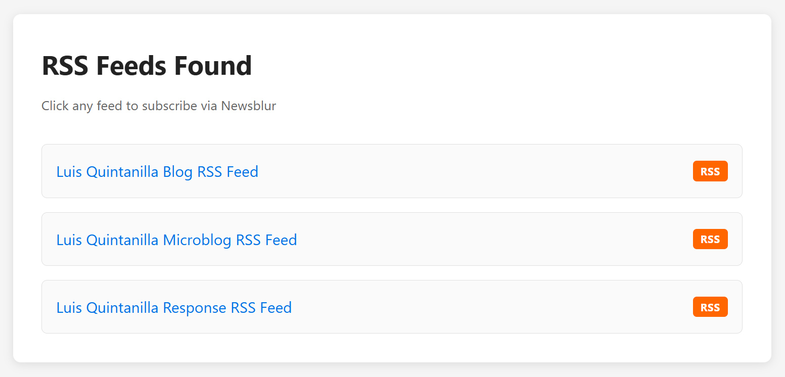

# RSS Feed Detector

A lightweight desktop extension for Chromium-based browsers (Chrome, Brave, Edge, etc.) that detects RSS, Atom, and JSON feeds and allows quick subscription via multiple RSS readers.



## Features

- Automatically detects RSS, Atom, and JSON feeds on any webpage
- Visual indicator: icon changes color when feeds are found
- Badge shows the number of detected feeds
- **Multiple RSS reader support**: NewsBlur, Feedly, Inoreader, The Old Reader
- **Custom reader support**: Add your own RSS reader with a custom URL pattern
- **Optional secondary action**: Configure a generic second button with its own label and URL template
- **Feed URL display**: See the actual feed URL for each detected feed
- **Copy to clipboard**: One-click copy of feed URLs for easy sharing
- Remembers your preferred RSS reader choice
- Clean, minimal interface with no popup clutter
- Works as a desktop extension in Chromium-based browsers using Manifest V3

## Installation

### From Source (Developer Mode)

1. Clone this repository:
   ```bash
   git clone https://github.com/lqdev/rss-browser-extension.git
   cd rss-browser-extension
   ```

2. Open your Chromium-based browser and navigate to `chrome://extensions/`

3. Enable "Developer mode" using the toggle in the top right corner

4. Click "Load unpacked" and select the `rss-browser-extension` directory

5. The RSS Feed Detector icon should now appear in your browser toolbar

## Usage

1. **Browse the web** - Visit any website that has RSS, Atom, or JSON feeds

2. **Watch for the indicator** - When feeds are detected:
   - The extension icon turns orange
   - A badge appears showing the number of feeds found

3. **View feeds** - Click the extension icon to open a new tab listing all discovered feeds

4. **Choose your reader** - Select your preferred RSS reader from the dropdown:
   - NewsBlur (default)
   - Feedly
   - Inoreader
   - The Old Reader
   - Custom Reader

   URL templates support `%s` for the feed URL, `%u` for the source page URL, and `%t` for the page title. Every occurrence is safely encoded with `encodeURIComponent`.

5. **Subscribe** - Click any feed action to open your chosen RSS reader with that feed pre-filled

6. **Optionally add a follow handoff** - Enter a secondary action label and URL template to add a second button to every feed. The documented personal example is:

   ```
   https://lqdev.github.io/github-post-pwa/share.html?intent=follow&feed=%s&url=%u&title=%t
   ```

   Leaving either secondary-action field blank hides the second action. The page title uses Open Graph `og:site_name` when available and otherwise falls back to the document title.

7. **Copy feed URL** - Click "Copy URL" to copy the feed URL to your clipboard

## How It Works

The extension uses these components:

- **Content Script** (`content.js`) - Scans web pages for RSS/Atom/JSON Feed links and captures page context
- **Background Worker** (`background.js`) - Manages the per-tab feed cache and icon states
- **Feeds Page** (`feeds.html` + `feeds.js`) - Displays feeds with multi-reader, secondary-action, and copy support
- **URL Helpers** (`feed-url-utils.js`) - Resolves HTTP/HTTPS URLs and safely expands repeated template placeholders

### Feed Detection

The extension looks for feeds in two ways:

1. Alternate links with `application/rss+xml`, `application/atom+xml`, or `application/feed+json`
2. Anchors with `application/rss+xml`, `application/atom+xml`, or `application/feed+json`

Relative feed URLs are resolved against the page URL. Non-HTTP/HTTPS URLs are ignored.

## Testing

Run the automated URL, placeholder, compatibility, and syntax checks:

```bash
npm test
```

Try visiting sites known to have RSS feeds:

- [TechCrunch](https://techcrunch.com)
- [The Verge](https://www.theverge.com)
- [Ars Technica](https://arstechnica.com)
- [Hacker News](https://news.ycombinator.com)
- Any WordPress blog (most have RSS feeds)

## Project Structure

```text
rss-browser-extension/
├── manifest.json          # Chrome extension manifest (MV3)
├── background.js          # Service worker for feed management
├── content.js             # Feed detection script
├── feed-url-utils.js      # URL validation and template expansion
├── feeds.html             # Feed list UI
├── feeds.js               # Feed list renderer
├── tests/
│   └── feed-url-utils.test.js
├── icons/
│   ├── icon.svg
│   ├── icon-active.svg
│   ├── icon.png
│   └── icon-active.png
├── docs/
│   └── prd.md
└── README.md
```

## Permissions

This extension requires the following permissions:

- `scripting` - To inject the content script that detects feeds
- `tabs` - To get information about the current tab
- `storage` - To store detected feeds and save reader/action preferences
- `clipboardWrite` - To copy feed URLs to the clipboard
- `<all_urls>` - To detect feeds on any website

## Development

### Building Icons

The icons are generated from SVG files:

```bash
cd icons
rsvg-convert -w 128 -h 128 icon.svg -o icon.png
rsvg-convert -w 128 -h 128 icon-active.svg -o icon-active.png
```

### Testing Changes

After making changes:

1. Go to `chrome://extensions/`
2. Click the refresh icon on the RSS Feed Detector card
3. Test on a website with feeds, a page without feeds, custom reader templates, and the optional follow handoff

## Scope

This enhancement targets desktop Chromium browsers. It does not add a Firefox or Edge Android port.

## Future Enhancements

- [ ] Feed preview before subscribing
- [ ] Keyboard shortcuts
- [ ] OPML export of discovered feeds
- [ ] Feed validation and health checks

## License

See [LICENSE](LICENSE) file for details.

## Contributing

Contributions are welcome. Please feel free to submit a Pull Request.
